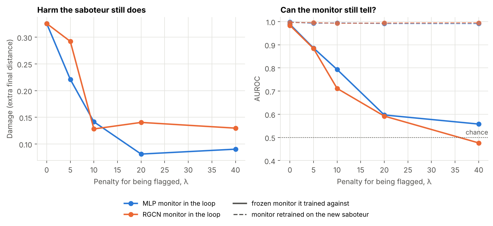
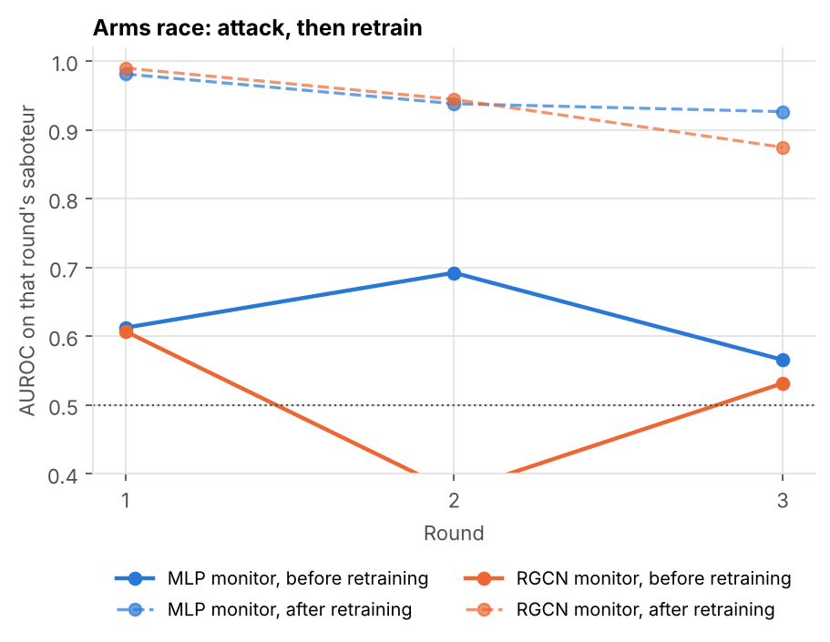
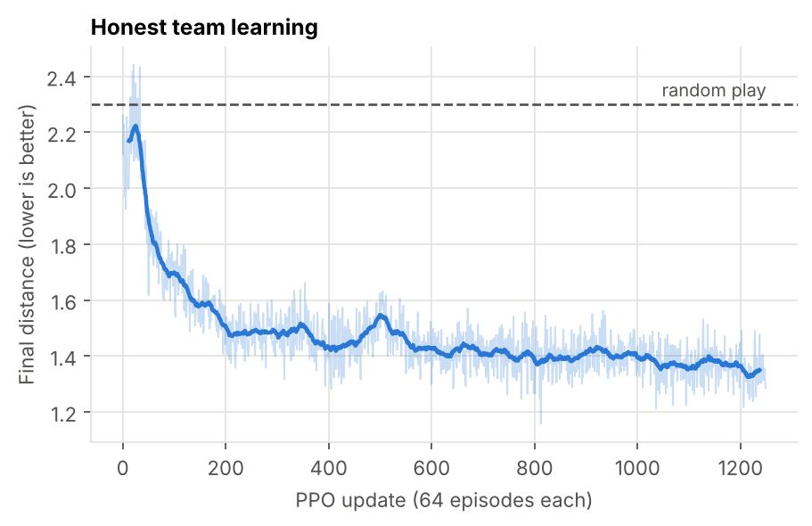
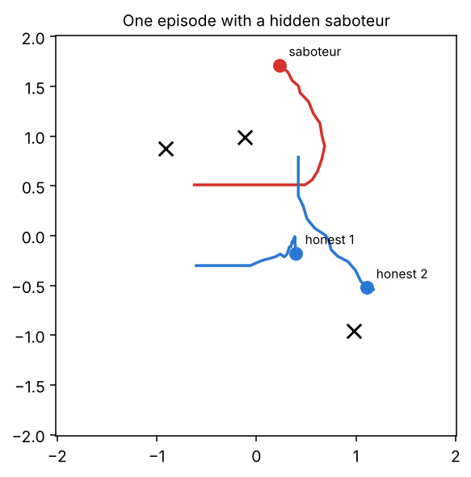

<div align="center">

# Under Watch

**Can a learned monitor catch a hidden saboteur inside a cooperative multi-agent team, and what happens once the saboteur is trained to avoid it?**

[](https://github.com/ysham123/under-watch/actions/workflows/tests.yml)


[](LICENSE)

[Findings](#key-findings) · [Setup](#setup) · [Results](#results) · [Reproduce](#reproduce) · [Limits](#limits)

</div>

<p align="center">
  
</p>

A team of three agents learns to cover three landmarks. In every episode one seat is secretly taken by a **saboteur** whose reward is the team's failure. Two **monitors** read finished episodes and score every agent for suspicion: an MLP over one agent's trajectory, and a relational graph network (RGCN) over typed agent and landmark relations. The saboteur is then trained to **pay for being flagged**, and the two sides alternate in an **arms race**.

The question is Goodhart's law in a setting small enough to inspect completely: does a monitor keep working once the thing it watches is optimised against it? Everything runs in JAX on a laptop CPU, end to end in under an hour.

## Key findings

All numbers are from one training run per setting; see [Limits](#limits).

| Finding | Number | What it means |
|---|---|---|
| A saboteur trained only to hurt the team is easy to catch | damage **+0.41** final distance (team 1.34 → about 1.75); held-out AUROC **0.999** (MLP), **0.998** (RGCN) | Unpressured sabotage is blunt: the saboteur leaves, ending outside the start area in 73% of episodes (honest agents: 35%). |
| Under pressure, the saboteur beats the frozen monitor it trains against | AUROC falls to **0.60** (MLP) and **0.59** (RGCN) at λ = 20; **0.48** for the RGCN at λ = 40 | Below 0.5 the saboteur looks *less* suspicious than honest agents. |
| Hiding costs harm | damage falls from **0.33** to **0.08** (MLP in the loop) and **0.14** (RGCN in the loop) at λ = 20 | Stealth and sabotage trade off; past λ of 10 to 20 the curves flatten. |
| The evasive saboteur is not truly indistinguishable | a monitor retrained on it scores **≥ 0.99** at every λ, for both designs | Evasion exploited one frozen monitor's blind spots rather than becoming honest. |
| The saboteur changes *how* it does harm | ends as close to landmarks as honest agents (**0.58** vs 0.59) but moves faster (**0.82** vs 0.61) and collides more (**0.94** vs 0.68) | The frozen monitors had learned "far from landmarks means saboteur"; contact and speed slipped past them. |
| Evasion transferred one way only | MLP-evaders also fooled the frozen RGCN (**0.60**); RGCN-evaders were still flagged by the frozen MLP (**0.73**) and kept more damage | In this run the graph monitor was the easier one to beat. |
| The defender keeps up in the arms race, by a shrinking margin | after retraining: **0.98, 0.94, 0.93** (MLP) and **0.99, 0.95, 0.87** (RGCN) over three rounds; damage **0.08 → 0.05** and **0.14 → 0.07** | Each round of hiding leaves less harm, and each retraining recovers a little less. |

## Setup

| Piece | Choice |
|---|---|
| World | Simple Spread (3 agents, 3 landmarks, 25 steps): a batched JAX port of PettingZoo MPE `simple_spread_v3`, matching the reference physics, rewards and observations step by step |
| Honest team | Shared-parameter PPO (GAE λ = 0.95, clip 0.2, 64 parallel worlds), 2M environment steps; final distance 2.30 (random) → 1.34 |
| Saboteur | One random seat per episode, hidden from everyone. Starts as a copy of the honest policy. Reward per step: the team's total landmark gap $D_t$. The honest team is frozen. |
| Damage | Final distance with the saboteur minus without it, on the same worlds and seats (paired) |
| MLP monitor | One agent's 25 × 18 observations, flattened, two hidden layers of 128 |
| RGCN monitor | Per time step: 6 nodes (agents, landmarks) and 6 relation types (agent↔agent, landmark→agent, agent→landmark, each split into *near* and *far*). Two RGCN layers, mean and max pooling over time, one logit per agent |
| Monitor training | Binary cross-entropy on 4,096 worlds; every score is reported on 2,048 held-out worlds |
| Pressure | Last-step reward $D_{24} - \lambda\,\sigma(m_\text{sab})$ from a frozen monitor; λ ∈ {0, 5, 10, 20, 40}; black box (no gradients through the monitor) |
| Arms race | Three rounds at λ = 20: attack the current monitor, then retrain it from scratch on every saboteur seen so far |
| Metrics | AUROC (chance 0.5), caught rate (top-scored agent is the saboteur; chance 1/3), damage |

## Results

### Pressure sweep

Saboteurs trained against the **MLP** monitor:

| λ | damage | frozen MLP | frozen RGCN | retrained MLP |
|---:|---:|---:|---:|---:|
| 0 | 0.33 | 0.988 | 0.984 | 0.998 |
| 5 | 0.22 | 0.886 | 0.809 | 0.992 |
| 10 | 0.14 | 0.793 | 0.789 | 0.995 |
| 20 | 0.08 | 0.597 | 0.598 | 0.992 |
| 40 | 0.09 | 0.558 | 0.634 | 0.992 |

Saboteurs trained against the **RGCN** monitor:

| λ | damage | frozen MLP | frozen RGCN | retrained RGCN |
|---:|---:|---:|---:|---:|
| 0 | 0.33 | 0.988 | 0.984 | 0.996 |
| 5 | 0.29 | 0.935 | 0.884 | 0.996 |
| 10 | 0.13 | 0.791 | 0.712 | 0.993 |
| 20 | 0.14 | 0.730 | 0.592 | 0.994 |
| 40 | 0.13 | 0.719 | 0.476 | 0.995 |

### What the saboteur does

Saboteur / honest agents, averaged over 2,048 episodes (`scripts/part9_behaviour.py`):

| Saboteur | Gap to nearest landmark | Left the start area | Speed | Collision steps |
|---|---:|---:|---:|---:|
| Unpressured | 1.33 / 0.65 | 0.73 / 0.35 | 0.78 / 0.65 | 0.76 / 0.59 |
| Evading the MLP (λ = 20) | 0.58 / 0.59 | 0.25 / 0.27 | 0.82 / 0.61 | 0.94 / 0.68 |
| Evading the RGCN (λ = 20) | 0.64 / 0.59 | 0.31 / 0.28 | 0.81 / 0.61 | 0.85 / 0.64 |

### Arms race

<table>
<tr>
<td width="55%"></td>
<td>

| Round | Monitor | Damage | Before | After |
|---:|---|---:|---:|---:|
| 1 | MLP | 0.08 | 0.613 | 0.982 |
| 2 | MLP | 0.05 | 0.692 | 0.938 |
| 3 | MLP | 0.05 | 0.566 | 0.927 |
| 1 | RGCN | 0.14 | 0.607 | 0.990 |
| 2 | RGCN | 0.12 | 0.374 | 0.945 |
| 3 | RGCN | 0.07 | 0.532 | 0.875 |

*Before*: the current monitor against the new saboteur. *After*: retrained on all saboteurs so far. In round 3 both retrained monitors still score above 0.99 on the original saboteur, so pooling prevents forgetting.

</td>
</tr>
</table>

<details>
<summary><b>Honest team training and the unpressured saboteur</b></summary>

<table>
<tr>
<td width="55%"></td>
<td width="45%"></td>
</tr>
</table>

</details>

## Reproduce

```bash
pip install -r requirements.txt
python scripts/part5_train_team.py          # honest team               ~2 min
python scripts/part6_train_saboteur.py      # unpressured saboteur      ~1 min
python scripts/part7_mlp_monitor.py         # MLP monitor               <1 min
python scripts/part8_rgcn_monitor.py        # RGCN monitor              ~2 min
python scripts/part9_pressure.py mlp        # pressure sweep            ~3 min
python scripts/part9_pressure.py rgcn       #                           ~10 min
python scripts/part9_behaviour.py           # behaviour comparison      <1 min
python scripts/part10_arms_race.py mlp      # arms race                 ~2 min
python scripts/part10_arms_race.py rgcn     #                           ~7 min
python scripts/part11_make_figures.py       # figures from results/
pytest -q                                   # 7 tests, ~30 s
```

Times are on a 4-core CPU. Every key is fixed, so a rerun reproduces the checkpoints bit for bit on the same machine. `scripts/part1` to `part4` are short walkthroughs of JAX, the world, the policy network and rollouts.

| Path | Contents |
|---|---|
| `underwatch/env.py` | Batched Simple Spread in pure JAX |
| `underwatch/nets.py` | MLP actor and critic |
| `underwatch/rollout.py` | Episodes with a hidden saboteur seat, datasets, paired damage |
| `underwatch/ppo.py` | GAE, clipped PPO, team and saboteur updates (with the monitor penalty) |
| `underwatch/monitors.py` | MLP and RGCN monitors, training, AUROC |
| `results/` | Every number above, as JSON |
| `figures/` | Every figure above, regenerated by `scripts/part11_make_figures.py` |

## Limits

* **One run per setting.** The λ = 0 row of the sweep is the same setting as the unpressured saboteur, yet its damage came out 0.33 instead of 0.41: floating-point differences amplified by training. Differences of that size are noise. Multi-seed runs with bootstrap intervals are the next step, and the transfer asymmetry in particular needs them before it can be trusted.
* **The honest team is frozen.** It cannot adapt to the saboteur.
* **One task and one saboteur objective** (the team's total landmark gap).
* **Monitors see full trajectories after the episode**, not partial or online views.
* **The honest team is moderate** (final distance 1.34 against 2.30 for random play). Damage is measured relative to it.

## License

MIT
